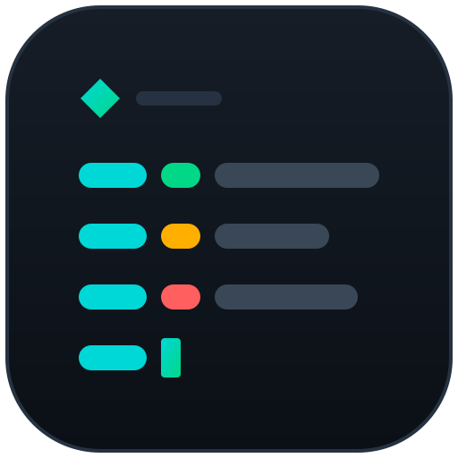

<p align="center">
	
</p>

# Segra Logger

`segra-logger` prints branded output for Segra and any other Node CLI. You set your branding once, then just log. Node.js 22.12 or newer is required, it works from both ESM and CommonJS (`require`), and there are no runtime dependencies.

## Install

```sh
npm install segra-logger

pnpm install segra-logger
```

## Setup, once

```ts
import { SegraLogger } from 'segra-logger';

const logger = SegraLogger.create({
	theme: { name: 'ACME', icon: '▲', banner: ['ACME', 'Welcome to ACME'], palette: { accent: '35' } }, // banner is optional
	level: 'DEBUG', // DEBUG | INFO | WARN | ERROR | SILENT, default INFO
	file: 'app.log', // optional: also append uncolored lines here
	mode: 'append' // 'append' (default) or 'live'
});
```

Every option is optional, and there are no on/off switches: what you provide is used. The banner prints once, just before the first log line, in either mode and whether you run a CLI or a long-lived app. By default it's the SEGRA banner; give `theme.banner` your own lines, or set `banner: []` to remove it:

```ts
SegraLogger.create({ theme: { banner: [] } }); // no banner
```

Anything you leave out of `theme` keeps the Segra default. A new `name` drops the SEGRA banner and tagline so they never show under your brand.
```txt
Providing name will mutate the default banner to [] and tagline to ''
```

## Two ways to print

Both modes use the same logger and the same branded line. Only `mode` changes. Set it for every logger in `create()`, or for one logger with `new SegraLogger('Context', { mode })`.

```ts
class HlsDownloader {
	private readonly logger = new SegraLogger(HlsDownloader.name);

	run() {
		this.logger.log('resolved %d segments', 42);
		this.logger.warn('retrying');
		SegraLogger.error('static calls work too');
	}
}
```

The methods are `debug`, `log` (same as `info`), `info`, `warn` and `error`, on an instance or as statics, plus `end()` for live loggers. A logger created before `create()` runs, for example at import time, still picks up its settings. Everything goes to stderr, so stdout stays free for data.

### `mode: 'append'` (default, NestJS style)

Each call adds a line:

```
[ACME] 4821  - 2026-10-27T12:23:12+0530  INFO [HlsDownloader] resolved 42 segments
[ACME] 4821  - 2026-10-27T12:23:12+0530  WARN [HlsDownloader] retrying
[ACME] 4821  - 2026-10-27T12:23:12+0530 ERROR static calls work too
```

### `mode: 'live'` (curl style)

Each `debug`, `log` or `info` call clears that logger's previous line and writes the new one in its place, under the banner. Use it for progress:

```ts
const download = new SegraLogger('Download', { mode: 'live' });

for (const [index, segment] of segments.entries()) {
	download.log('segment %d/%d', index + 1, segments.length); // rewrites the same line
}

download.end(); // keeps the last line on screen as normal output
```

- Each logger keeps its own line, so concurrent jobs stack instead of overwriting each other. A message can span several lines, which makes a progress panel.
- `end()` turns the logger's last line into normal output. Once no live logger is left, the cursor and console are restored. Logging again later starts a new live line.
- `warn` and `error` are always appended above the live lines, so a problem isn't wiped by the next update. The same goes for append-mode loggers.
- Plain `console.log` output is moved above the live lines. A library that doesn't own the process can opt out with `new SegraLogger('Job', { mode: 'live', captureConsole: false })`; foreign writes may then be erased by the next update.
- If you never call `end()`, the last line stays on screen and the cursor is restored on exit and on Ctrl+C. Register your own cleanup with `SignalHandler.register()` so only one place decides when the process exits.
- Without a TTY (piped or in CI), live lines are appended like append mode.

## Progress

`SegraProgress` draws job progress with the same theme and mode, so an app doesn't need a progress manager of its own. In live mode it's a panel redrawn in place; in append mode, or without a TTY, it's one summary line per update. Speed and ETA are worked out for you.

```ts
import { SegraProgress } from 'segra-logger';

const progress = new SegraProgress('Download');

progress.status('DOWNLOADING');
progress.count('Items', 3, 178);
progress.transfer('a', { label: 'video.mp4', bytes: 5e6, totalBytes: 1e7 }); // or segments / totalSegments
progress.detail('Source', 'https://cdn.example.com/a/video.mp4'); // URLs are shortened
progress.message('resolving playlist');
progress.end('COMPLETED', 'success'); // final frame stays on screen
```

- `status`, `detail` and `end` take an optional tone: `accent`, `success`, `warn`, `danger` or `muted`.
- Each `transfer` key gets its own row, and the panel totals bytes, rate and ETA across them. Finished transfers stay visible, up to the last three.
- After `end()`, further calls are ignored until `start()`, so a late update can't repaint a finished job. `start()` also takes `{ display, captureConsole, mode }` for the next run.
- Every change emits `update` with a snapshot, for callbacks: `progress.on('update', (snapshot) => …)`. With `{ display: false }`, nothing is drawn and only the events fire.

## Color

Colors come from the theme `palette`, written as ANSI SGR parameters such as `35` or `38;5;44`. Output is uncolored when `NO_COLOR` is set, when `TERM=dumb`, or when the stream is not a TTY. `FORCE_COLOR=1` turns color back on. To color your own text with the theme, use `new Style().accent('text')`.

## Development

```sh
pnpm install
pnpm typecheck
pnpm test   # builds, then checks the brand name, banner, levels, log file and both modes
```
